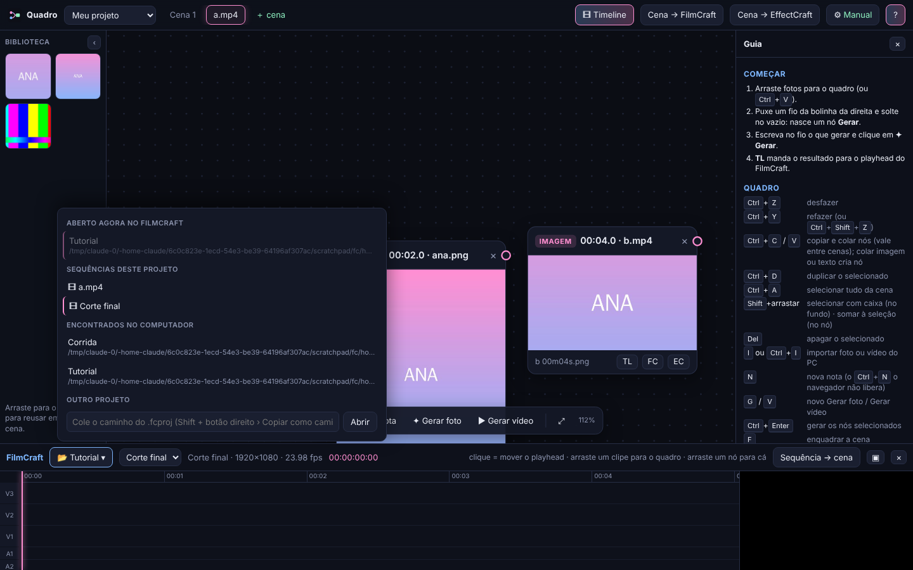

# Quadro ArtCraft

Um quadro de nós para criar filmes cena a cena com IA, ligado aos apps da suíte **ArtCraft** (FilmCraft, EffectCraft, PhotoCraft e os outros) e ao **Claude** por MCP.

- Suba fotos (personagem, cenário), puxe fios até um nó **Gerar** e escreva no fio o que quer: "a arara azul vem perto da lente e vai embora".
- O resultado vira versão do nó e vai para a **timeline do FilmCraft**: no playhead, numa faixa livre, ou trocando o clipe de onde a cena veio.
- A timeline do FilmCraft aparece dentro do quadro, ao vivo: escolha o projeto e a sequência, mova o playhead e traga clipes para o quadro.
- O Claude enxerga e edita o mesmo quadro ("como está a cena 4?", "melhora os prompts", "coloca a versão nova no playhead").



## Instalar

**Programa (Windows):** baixe `quadro-artcraft-windows.zip` em [Releases](../../releases/latest), extraia e abra **Quadro ArtCraft.exe**. O quadro abre em http://localhost:7700. Ele se atualiza sozinho a partir deste repositório.

**Extensão do Claude Desktop:** baixe `artcraft-claude.mcpb` em [Releases](../../releases/latest) e instale em Configurações › Extensões › Instalar extensão.

**Servidor MCP direto do GitHub** (Claude Code ou qualquer cliente MCP, com Node 20+):

```bash
claude mcp add artcraft -- npx -y github:OWNER/quadro-artcraft
```

```json
{ "mcpServers": { "artcraft": { "command": "npx", "args": ["-y", "github:OWNER/quadro-artcraft"] } } }
```

## Ferramentas MCP

| Ferramenta | O que faz |
|---|---|
| `artcraft_status`, `artcraft_abrir`, `artcraft_ferramentas`, `artcraft_usar` | descobrem os apps ArtCraft instalados, abrem com o canal de controle e repassam qualquer comando oficial de cada app |
| `quadro_abrir`, `quadro_ver`, `quadro_editar` | abrem, leem (resumo curto, gasta poucos tokens) e editam o quadro |
| `quadro_gerar` | gera foto ou vídeo pelos modelos da ArtCraft (API oficial) ou fal.ai |
| `quadro_enviar` | manda resultados para o FilmCraft / EffectCraft, num bin por cena |
| `quadro_timeline` | lê a sequência do FilmCraft, traz clipes para o quadro, coloca no playhead, troca o clipe de origem |

## Geração

O quadro usa a **API oficial da ArtCraft** (a chave é liberada por conta pela equipe da ArtCraft) ou a **fal.ai**, configuradas no ⚙. Sem chave, o modo **Manual** copia o prompt, abre as referências e puxa sozinho o arquivo que o ArtCraft salvar (ligue *Settings › Downloads › Auto Download* no ArtCraft).

## Desenvolvimento

```bash
npm run quadro        # só o quadro, abre o navegador
npm run mcp           # servidor MCP (stdio)
npm run testar        # checagem rápida
npm run montar:exe    # dist/: .mcpb, programa Windows e o pacote de atualização
```

Publicar uma versão: suba `VERSAO` em `server/index.js`, rode `npm run montar`, faça commit (inclui `versao.json` e `quadro-bundle.js`, que a atualização automática baixa) e crie a tag `vX.Y.Z`. O GitHub Actions monta o `.exe` e o `.mcpb` e publica o Release.

Mais detalhes: [guia de uso](docs/GUIA.md) · [como funciona](docs/ARQUITETURA.md) · [próximos passos](docs/ROADMAP.md).

## Licença

MIT. ArtCraft, FilmCraft e EffectCraft são da equipe Storyteller/ArtCraft; este projeto só conversa com eles pelos canais oficiais (MCP de cada app e Omni API).
